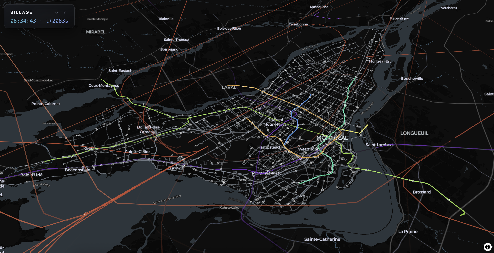

# Sillage

**Montréal's transit network, drawn as the trails its vehicles leave behind.**

[](https://kyuchia.github.io/sillage/)

<sub>Greater Montréal, 08:00–09:00: buses, métro, REM, commuter trains and aircraft replayed as animated trails. Colour identifies the mode; brighter trails are faster.</sub>

Sillage records live STM bus and OpenSky aircraft positions in a PostGIS database, simulates métro, REM and commuter rail from static GTFS schedules, and replays them together on one timeline with deck.gl and MapLibre. *Sillage* is French for the wake a boat leaves on water.

The [published demo](https://kyuchia.github.io/sillage/) plays precomputed scenes and needs no backend. When run locally, the application can query arbitrary time windows from a populated PostGIS database.

---

## Overview

Two Python fetchers can poll public APIs every 20 seconds, storing position fixes in PostgreSQL. A FastAPI backend reads a requested time window, merges recorded positions with schedule-simulated modes on a shared timeline, and returns the paths and timestamps deck.gl's `TripsLayer` expects. In the browser, the window can be scrubbed, sped up, and filtered by mode.

The recorded-layer API also has a Kotlin/Micronaut implementation, checked against the FastAPI version by parity tests — see [Kotlin API](#kotlin-api).

**Recorded data.** The project collected 25,520,876 bus and aircraft positions in April and August–September 2026, with gaps between recording periods. Collection has ended, and the recordings are not included in this repository.

| Layer      | Choice                                                     |
| ---------- | ---------------------------------------------------------- |
| Ingestion  | Python, `gtfs-realtime-bindings`, `opensky-api`            |
| Storage    | PostgreSQL 17, PostGIS 3.6                                 |
| API        | FastAPI; a second implementation in Kotlin with Micronaut  |
| Simulation | Static GTFS interpolation along `shapes.txt`               |
| Frontend   | MapLibre GL JS, deck.gl `TripsLayer` / `ScatterplotLayer`  |
| Testing    | pytest, JUnit 5, Playwright, GitHub Actions on PostGIS     |

---

## Technical highlights

**Spatiotemporal storage.** Each position table has a generated PostGIS `geography` column with a GiST index, and a B-tree index on `fetched_at` for time-range scans ([`db/schema.sql`](db/schema.sql)). Buses within 500 m of Place-des-Arts during a morning peak, by route:

```sql
SELECT route_id, COUNT(DISTINCT vehicle_id)
FROM vehicle_positions
WHERE fetched_at >= '2026-08-20 08:00-04:00' AND fetched_at < '2026-08-20 09:00-04:00'
  AND ST_DWithin(geom, ST_MakePoint(-73.5772, 45.5048)::geography, 500)
GROUP BY route_id
ORDER BY 2 DESC;
```

**Rendering.** Timestamps are seconds from the start of the window rather than epoch values, avoiding precision loss in deck.gl's interpolation. `TripsLayer` draws trails but not vehicles, so the client binary-searches each vehicle's timestamps, interpolates its current position, and draws it with `ScatterplotLayer`. Hue encodes mode and brightness encodes speed; official colours are kept where they exist, and `scripts/check_colours.js` fails the build when two ramps become perceptually too close (CIEDE2000).

**Schedule simulation.** STM publishes no `shape_dist_traveled`, so stops are projected onto route shapes, constrained to move forward where a route passes near itself. Service times past midnight (`25:30:00`) are assigned to the previous service day, and recordings outside a feed's validity are matched to a compatible service date.

---

## Getting started

Requires PostgreSQL 17 with PostGIS and Python 3.12.

```bash
git clone https://github.com/kyuchia/sillage.git && cd sillage
python3 -m venv venv && source venv/bin/activate
pip install -r requirements.txt
createdb sillage && psql sillage < db/schema.sql

python scripts/fetch_gtfs.py          # static GTFS for the simulated modes
uvicorn api.main:app --port 8000      # then open http://localhost:8000/
```

**Optional: collect new positions.** A fresh database is empty; the recorded layers fill only while the fetchers run. This needs an [STM API key](https://portail.developpeurs.stm.info/apihub) and, for authenticated OpenSky access, OAuth2 credentials, supplied through environment variables or the macOS Keychain.

```bash
python fetchers/stm_fetcher.py        # buses, every 20 s
python fetchers/opensky_fetcher.py    # aircraft, every 20 s
```

URL parameters are passed to the API, e.g. `/?layer=all&start=2026-08-20%2008:00-04:00&end=2026-08-20%2009:00-04:00`. `layer` accepts `bus`, `aircraft`, `metro`, `train`, `rem`, `both`, `all`, or a comma-separated list.

The published demo's scenes are cut from the running API with `./scripts/bake_scenes.sh` into `docs/scenes/`.

---

## Testing

[](https://github.com/kyuchia/sillage/actions/workflows/test.yml)

Tests run against a throwaway PostGIS database built from `db/schema.sql` and a small seed with planted defects (`tests/fixtures/seed.sql`), never against the archive. They cover the API contract and its error handling, the schema, and nine SQL data-quality checks. GitHub Actions runs them on every push, together with the Kotlin job below.

```bash
pip install -r requirements-dev.txt
createdb sillage_test
SILLAGE_TEST_DSN="dbname=sillage_test" pytest
```

End-to-end tests (`tests/e2e/`) load the static demo with Playwright in Chromium, Firefox and WebKit, at desktop and phone (390×844) sizes. They check that the map and trail overlay render, the controls, scene switching and About dialog work, nothing is logged as a console error, and every request succeeds; WebGL output is not compared pixel by pixel. CI serves this checkout's `docs/` and runs one job per browser.

```bash
python -m playwright install chromium firefox webkit
python -m http.server 8765 --directory docs &
pytest tests/e2e --base-url http://localhost:8765/ --browser chromium --browser firefox --browser webkit
# or against the live demo: --base-url https://kyuchia.github.io/sillage/
```

---

## Kotlin API

[`api-kotlin/`](api-kotlin/) reimplements the database-backed endpoints — `/api/health`, `/api/range` and `/api/trips` for the recorded layers (`bus`, `aircraft`) — in Kotlin with Micronaut, reading the same tables and returning the same JSON. Query logic is independent of the HTTP layer, table names come from a fixed enum, and every request value is a bound parameter. GTFS simulation stays in Python; the port answers simulated layers with a 400.

Automated parity tests (`scripts/parity_kotlin.py`) compare the Kotlin and FastAPI responses. All 55 seeded cases pass in CI, with an additional 8 cases passing against the recorded archive.

```bash
cd api-kotlin
SILLAGE_TEST_DSN="dbname=sillage_test" ./gradlew test installDist   # JDK 21
cd .. && PG_DSN="dbname=sillage_test" python scripts/parity_kotlin.py --launch
```

---

## Data sources

| Mode              | Source                                                                  | Rendering          | Terms     |
| ----------------- | ----------------------------------------------------------------------- | ------------------ | --------- |
| STM bus           | [STM](https://www.stm.info/en/about/developers/terms-use) GTFS-Realtime | Recorded           | CC BY 4.0 |
| Aircraft          | [The OpenSky Network](https://opensky-network.org/) API                 | Recorded           | See terms |
| STM métro         | [STM](https://www.stm.info/en/about/developers/terms-use) static GTFS   | Schedule-simulated | CC BY 4.0 |
| REM               | [CDPQ Infra](https://rem.info/) static GTFS                             | Schedule-simulated | CC BY 4.0 |
| exo commuter rail | [exo / ARTM](https://exo.quebec/en/about/open-data) static GTFS         | Schedule-simulated | CC BY     |

Basemap © [CARTO](https://carto.com/attribution/), © OpenStreetMap contributors.

> Schäfer, M., Strohmeier, M., Lenders, V., Martinovic, I., and Wilhelm, M. 2014. "Bringing Up OpenSky: A Large-scale ADS-B Sensor Network for Research." *IPSN '14*.

## License

Source code: [MIT](LICENSE). The baked scenes in `docs/scenes/` contain derived transit and aircraft data and remain subject to the providers' terms above.
